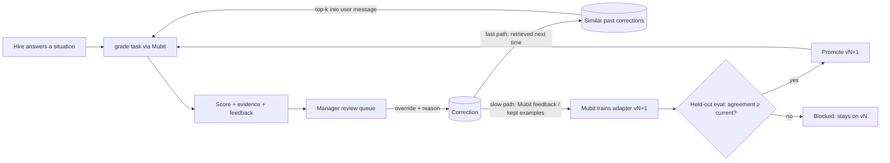

# GymQuest: final hackathon plan (Night Shift × Mubit)

Merged from four plans: [Ethan](plans/01-ethan.md), [Nicole](plans/02-nicole.md), [Faiza](plans/03-faiza.md),
[Richard](plans/04-richard.md). Status as of Fri 23 Oct 2026, 21:30 BST. Code freeze Sun 25 Oct, 10:00.

## 0. TL;DR

**GymQuest turns any company's onboarding material into a Pokémon-style world that new hires in any role play
through.** Hires walk the office, battle trainers, dodge phishing in the long grass and beat gym bosses. They answer
real work situations in their own words, and an AI grader scores those answers against company policy. Every time a
manager or SME corrects a grade, Mubit turns the correction into a model update. Over the weekend, the grader goes from a
generic frontier model to a company-adapted model that agrees with the company's experts more, costs less and runs
faster.

- **Track: Recurring tasks** (primary). Grading hire answers is the recurring task: every hire, every role, every
  scenario, plus annual compliance refreshers for all staff. The other two tracks each get a short beat in the demo,
  since the top 3 prizes are judged across all tracks.
- **One star task, trained hard:** `grade`. One secondary task, `generate`, is routed through Mubit and corrected,
  and trained only if time allows. We don't spread ~100 corrections across four tasks.
- **For any role:** company, compliance and role knowledge are separate **content packs**. Engineering is one role
  pack; support is another. A new pack uploaded on stage turns into a playable gym in under a minute.
- **The demo proves it:** a manager's correction → an instant fast-path change → adapter v2 beats the frontier model
  on held-out agreement, cost and latency → a new role pack is generated live.
- **Build order:** correction loop first, game layer second. A walkable world is the hook, not the product.

---

## 1. Event brief (what we're judged on)

| Criterion (25% each) | How we win it |
|---|---|
| **Use of Mubit**: show a correction turning into a model update | A live override, the fast-path effect seconds later, and adapter versions v0 → v1 → v2 on a learning timeline with held-out agreement, read from Mubit's console |
| **Usefulness**: a real recurring task | Every company onboards every role; every answer from every hire gets graded; compliance training is mandatory every year (SOC 2 / ISO 27001, which Mubit itself holds) |
| **Technical execution**: works and holds up to questions | A held-out eval set labelled by humans, objective verdicts only, a regression gate, a fixed system prompt per task, a local fallback for every live dependency |
| **Demo**: clear, live, under time | A scripted 3:00 run on a seeded, resettable state; a backup video; no live dependency on judges' phones |

**Tracks:** recurring tasks (our pick) · own your intelligence layer (beat: adapter vs frontier on quality, cost and
latency) · fast refresh (beat: a new pack or policy change regenerates content live).

**Mubit's own models we can use:** [Banyan Sapling](https://huggingface.co/MubitLabs/banyan-sapling) checks claims
against policy and evidence and abstains when information is insufficient, which suits our grader as a verifier (§6.4).
[Latte Bench](https://github.com/MubitLabs/latte-bench) asks whether models learn from feedback; we cite it in the
pitch ("we show the same thing on onboarding").

---

## 2. The product

### Problem

- Only 12% of employees strongly agree their organisation onboards well, and 29% of new hires feel fully prepared
  (Gallup).
- Knowledge lives in scattered docs, Slack threads and senior people's heads. Two hires in the same role finish
  onboarding knowing different things. Competence is assumed, not shown. (Richard)
- Compliance training is generic video, and chatbots give stale answers once policies change. (Ethan)
- Managers re-check the same kinds of answers for every hire. That's a recurring task nobody automates well,
  because "good" is company-specific.

### Who it's for

Any company that onboards people regularly: scale-ups hiring across departments and high-volume frontline employers.
The buyer is People/L&D together with compliance; team leads are the experts whose corrections train the grader.
The same engine serves a support agent, a warehouse lead, a salesperson or an engineer. Only the content pack changes.

### One sentence

Upload your onboarding material, and GymQuest builds a game that teaches it, grades how each hire handles real
situations, and learns your experts' standards from every correction they make.

### The content-pack model (what makes it general)

A **content pack** is `{ documents, roles, competencies + rubric, gym config }`. The engine, the grader and the
Mubit tasks stay the same across packs. (This is Nicole's platform idea; Ethan's three tiers become pack types.)

| Pack type | Who plays it | Examples | In-game form |
|---|---|---|---|
| **Company** | Everyone | Values, who owns what, tools, expenses, escalation | Town Hall NPCs and a short quiz |
| **Compliance** | Everyone, refreshed yearly | Phishing, data protection, gifts and bribery, tailgating, fire safety | Security HQ gym, plus **random phishing encounters** anywhere on the map |
| **Role** | Per role | Support: refunds, bank-detail changes, vulnerable customers. Engineering: legacy payments incident. Ops/Sales/etc. | One gym per role. Trainers, then an adaptive Gym Leader boss |

### Principles (from all four plans)

1. **Role judgment, not general ability.** We assess whether a hire does the right thing *in this company's
   situations*. That has ground truth (policy plus manager rulings) and can be validated; personality or IQ-style
   scoring can't. (Nicole)
2. **Objective verdicts only.** Training signals come from human reviewers or known labels, never from the model
   grading itself. (Ethan)
3. **Separate generation from validation.** A model proposes a question; the company approves the expected answer,
   the source and the rubric. (Richard)
4. **Formative, with human sign-off.** Scores adapt the learning path. A badge means *eligible*: a manager signs off
   before any real access or responsibility. This keeps us out of the EU AI Act's Annex III high-risk employment
   uses. (Nicole, Richard)
5. **Every card cites its source.** Every question and grade links to the doc chunk and policy version behind it.
   (Faiza, Ethan)

---

## 3. Demo company and world: Acme Pay

A fictional fintech scale-up with ~200 staff across support, ops, engineering and sales. It has no real-company
material. The handbook is synthetic. Fintech gives us high-stakes, policy-heavy situations for every role.

```
 ┌────────────┐   ┌──────────────┐   ┌──────────────┐
 │ Town Hall  │   │ Security HQ  │   │ Support Gym  │
 │ company    │   │ compliance   │   │ role pack    │
 └─────┬──────┘   └──────┬───────┘   └──────┬───────┘
       │   long grass: wild phishing encounters  │
 ┌─────┴──────┐   ┌──────┴───────┐   ┌──────┴───────┐
 │ Engineering│   │  🔒 locked    │   │  Your desk   │
 │ Gym        │   │  new pack     │   │  passport    │
 │ role pack  │   │  (live demo)  │   │              │
 └────────────┘   └──────────────┘   └──────────────┘
```

| Location | Depth we build | Hero content |
|---|---|---|
| **Security HQ** | Full: 2 trainers + boss; phishing inbox encounters | Spot the phish; a "customer" emails asking to change payout bank details urgently |
| **Support Gym** | Full: 2 trainers + adaptive boss | Refund over limit, bank-detail change request, vulnerable customer, complaint escalation |
| **Engineering Gym** | Light: 1 trainer + boss | Richard's Legacy Dungeon → Production Guardian (failed payments deploy: diagnose, runbook, safe rollback, escalate) |
| **Town Hall** | Minimal: NPC dialogue + one quiz | Expenses, who owns what |
| **Locked building** | Generated live on stage | Admin uploads a new role pack (e.g. Warehouse Ops or Sales); the door unlocks with a playable gym |

---

## 4. Game design

- **Overworld (Phaser):** one Tiled map with grid movement (about 50 lines, no plugins). Doors trigger gyms; long
  grass triggers wild phishing encounters. Phaser emits events (`encounter:phish`, `enter:gym`) and React opens the
  matching screen. (Ethan)
- **Battles (React DOM + CSS):** turn-based with HP. The opponent's creature "attacks" with a situation. A good
  answer lands your counter-attack; a weak answer hits you. HP 0 means retry. (Faiza)
  - **Multiple choice** for facts (fast, deterministic).
  - **Free text** for judgment ("A customer emails asking to change their bank details today. What do you do?").
    These are what the grader scores and managers correct, so **every gym needs free-text questions**.
- **Grade display:** 0–3 per competency, an evidence quote from the hire's answer, one line of feedback, the cited
  policy, and "what an expert would do". (Nicole)
- **Gym Leader boss:** questions are weighted ~60% toward the topics this learner failed. You can't clear a gym
  without fixing your weak spots. A failed competency comes back as a *different* scenario testing the same skill, so
  hires learn instead of memorising. (Faiza, Richard)
- **Progress:** badges, a skills passport (gyms cleared, competencies shown, gaps, dates, policy version attested).
  XP and a leaderboard are optional. (Richard, Nicole)
- **Art:** Kenney CC0 tilesets. Creatures are PokeAPI Gen V animated sprites behind a `SPRITE_SOURCE` flag with a CC0
  fallback. **IP note:** Pokémon is a fan-project style for the demo only; any release needs an original reskin, and
  "Pokémon" stays out of the product name.

### Manager and admin side

- **Review queue:** approve, or override a score and add one line of reasoning (the correction). Generated cards get
  approve/edit/reject. Inline edits only; Faiza's dnd-kit editor is cut.
- **Readiness dashboard:** per-hire passport, per-role coverage ("which systems have too few qualified people").
- **The game audits the docs:** if many hires fail the same question, its source doc is flagged as ambiguous or
  missing. (Faiza; Ethan's "doc gaps")
- **Learning timeline (the Mubit panel):** corrections → kept examples → training runs → versions → agreement curve,
  plus a live feed of grades as they happen. Judges watch the system learn. (Faiza, Nicole)
- **xAPI export:** audit events shaped as xAPI statements with the policy version in `object.id`. One button and a
  slide: "lands in your LMS via xAPI/cmi5". (Ethan)

---

## 5. How a correction becomes a model update



- **Fast path (instant, on stage):** a correction is embedded and stored. The next similar answer retrieves it into
  the *user message*, so the grader applies the new standard straight away. (Nicole)
- **Slow path (the model update):** the correction reaches Mubit's training data, and the next adapter learns it into
  its weights.
  - **Primary:** Mubit's own correction or feedback mechanism (confirm at kickoff; the hackathon brief implies one
    exists).
  - **Fallback:** distil from the fast path. Calls made with the right correction retrieved produce corrected outputs,
    Mubit keeps them as examples, and the adapter learns them.
  - Code goes behind one `FeedbackSink` interface so we can switch without touching the rest.
- **Versions:** v0 = frontier model through Mubit. v1 = adapter distilled from v0's own outputs; it should match v0 on
  agreement at lower cost and latency (*own your intelligence layer*). v2 = adapter trained after manager corrections;
  it should **beat** v0 because it learned the company's standard (*recurring tasks*).
- **Regression gate:** a candidate version is promoted only if held-out agreement ≥ the current version. If a real
  regression happens we show it blocked; we never fake one. (Ethan)
- **Prompt rule:** each task's system prompt is fixed and versioned in code, with a snapshot test. Everything that
  varies (pack, rubric, scenario, answer, retrieved corrections) goes in the user message. Otherwise Mubit splits the
  calls into a new task and our examples scatter. (Nicole)

---

## 6. Mubit tasks

| Task | Role | Input → output | Corrected by | Metric |
|---|---|---|---|---|
| **`grade`** ⭐ | The one we train hard. One general grader for all packs | pack, competency rubric, scenario, policy excerpt, answer, top-k similar corrections → JSON `{ scores: {competency: 0–3}, evidence_quote, feedback, gap }` | Manager or SME override + reason | Agreement with held-out human labels (exact and within-1), MAE, cost per 1k, p50/p95 latency |
| **`generate`** | Secondary. Trained only if it reaches the threshold | doc chunk + role + type (`mcq`, `free_text`, `phish_email`, `incident`) → card JSON with rubric and citation | SME approve/edit/reject; security reviewer for phish ("too obvious") | Acceptance rate |
| **`verify`** (stretch) | Banyan Sapling, if Mubit hosts it | policy excerpt + hire's claim → supported / contradicted / insufficient | — | When it says *insufficient*, the grade goes to the human queue, which creates more corrections |
| **`npc`** (stretch) | Character dialogue for flavour | — | — | — |

- **Why one general grader?** It's the stronger platform story (the same model grades any role pack) and keeps every
  correction in one task, so it reaches the training threshold sooner. **Fallback:** if the general adapter misses
  its target, split into `grade-security` and `grade-support`. Ask Mubit at kickoff which they recommend.
- Ethan's `phish-gen` and `battle-gen` become content types of `generate`. `mentor-qa` is cut.

### Evaluation set

- **Held-out:** 40 answers labelled by a manager (Nicole leads). They are never corrected through the app or used in
  training.
- **Train corrections:** 60+ overrides made in the review queue on other answers.
- `npm run eval -- --model <id>` runs the held-out set against any version and writes agreement, MAE, cost and
  latency to `eval/results/<version>.json`. The learning timeline reads these files.
- Choose the hero demo scenario from **real v0 mistakes** in the data, not one we invent.

---

## 7. Architecture and stack

| Layer | Choice | Why (and which plan) |
|---|---|---|
| App | **Next.js (App Router) + TypeScript**, deployed on Vercel | Three of four plans chose it. One deploy serves player, admin and API, and gives judges a URL/QR |
| Game | **Phaser 4** in a client-only component (`dynamic(..., { ssr: false })`); **fall back to Phaser 3.90** if v4 causes problems | Code-first 2D web default (Ethan) |
| Maps | Tiled → JSON, Kenney CC0 | Free and licence-safe (Ethan) |
| UI | React + Tailwind + Zustand; battles in DOM + CSS | Text-heavy screens are faster in React (Ethan, Faiza) |
| DB | **Postgres on Neon + Drizzle + pgvector** | Corrections retrieval for the fast path (Nicole, Richard) |
| Validation | Zod schemas for `Card`, `Grade`, `Correction`; LLM JSON is validated before use | Ethan |
| LLM | `openai` npm client with `baseURL = MUBIT_BASE_URL` (Nicole has `https://api.mubit.ai/openai/v1`; confirm), embeddings via Mubit `/embeddings` | One-line Mubit integration |
| Bulk jobs | Local `tsx` scripts (persona answers, bulk grading, eval), not serverless | Avoids function timeouts |
| Resilience | Local `Weakness` mirror; cached v0 grades for seeded answers; `npm run demo:reset` | The demo survives API flakes (Faiza, Richard) |

### Data model (sketch)

```ts
Company    { id, name, slug }
Pack       { id, companyId, type: 'company'|'compliance'|'role', role?, title }
Doc        { id, packId, title, version, body, updatedAt }
DocChunk   { id, docId, docVersion, text, embedding }
Gym        { id, packId, name, leaderName, order, locked }
Card       { id, gymId, type, prompt, choices?, answerIdx?, rubric, sourceChunkId, docVersion, status: 'draft'|'approved'|'stale' }
Learner    { id, companyId, name, role }
Attempt    { id, learnerId, cardId, answerText?, choiceIdx?, gradeId?, correct, createdAt }
Grade      { id, attemptId, modelVersion, scores, evidenceQuote, feedback, gap, latencyMs, costUsd, mubitRequestId }
Correction { id, gradeId, correctedScores, reason, reviewer, embedding, createdAt }
Weakness   { learnerId, competency, attempts, fails }
ModelVersion { id, task, mubitModelId, trainedAt, heldOutAgreement, mae, costPer1k, p50Ms, status: 'candidate'|'promoted'|'blocked' }
```

### Fast refresh

- **Policy changes:** editing a doc bumps its `version`. Every card citing an older chunk is marked `stale` and
  regenerated through `generate`. Corrections tied to the old policy version are flagged for re-review. (Ethan)
- **New domain:** uploading a new pack chunks and embeds its docs, generates a gym (cards plus rubric), and unlocks a
  building on the map. The same grader scores it immediately. Target: under 60 seconds. (Nicole)

---

## 8. Data preparation (Nicole leads)

| Item | Amount | How |
|---|---|---|
| Acme Pay handbook | ~15 pages across packs: company (2), compliance (5), support (5), engineering runbook + incident report (3) | Written by us, with policy-specific rules a generic model wouldn't know (e.g. bank-detail changes only via callback to the number on file; refunds over £250 need team-lead approval) |
| Scenarios | Generate ~30, keep 12 (4 security, 5 support, 2 engineering, 1 company) | `generate` + human pick; these first approvals are corrections too |
| Synthetic answers | ~300 from personas: beginner, careless, over-promiser, policy-literal, model answer | Script; this is also the bulk traffic that fills Mubit's kept examples |
| Held-out labels | 40 | Manager labels, kept separate |
| Corrections | 60+ (target 100) | Review queue, Saturday morning and afternoon |
| Second-domain pack for the live demo | 2–3 pages (Warehouse Ops or Sales) | Kept unseen until the demo |

---

## 9. Team

| Person | Area | Owns |
|---|---|---|
| **Ethan** | Platform and Mubit plumbing | Scaffold, DB, LLM client and task registry, `FeedbackSink`, correction API and fast path, fast refresh, xAPI, deploy, demo reset |
| **Nicole** | Intelligence and data | Grader prompt and rubric, `generate` prompt, handbook, personas, held-out labels, corrections, eval harness, training schedule, the agreement numbers |
| **Faiza** | Learner experience | Battle UI (MC + free text), grade display, adaptive boss and weakness, review queue UI, learning timeline / Mubit panel |
| **Richard** | World and story | Phaser overworld, encounters, gym doors, engineering gym content, passport and dashboard, doc-audit view, pitch deck, demo script, backup video |

Everyone: route Claude Code through Mubit and enter the Model Card side quest (§16).

---

## 10. Timeline (built around Mubit's training windows)

Known constraints (from Nicole; confirm at kickoff): training starts at **25 kept examples** by default; there is a
**daily training limit that resets at 00:00 UTC**, an **enforced pause between trainings**, and **3 Try models
starts per UTC day**. In BST, the UTC day flips at **01:00** on both Saturday and Sunday. **Clocks go back at 02:00
on Sunday**, which gives an extra hour. That means three training windows: **Friday** (until 01:00 BST Sat),
**Saturday** and **Sunday**.

| When (BST) | Work | Checkpoint |
|---|---|---|
| **Fri 21:30–22:30** | Everyone: agree this plan. Ethan: scaffold, Mubit key, first call. Someone asks Mubit the §15 questions | First request visible in Mubit's Requests view |
| **Fri 22:30–00:30** | Nicole: grader prompt and rubric, handbook, scenarios, persona script. Ethan: DB, `/api/grade`, seed. Faiza: battle UI on mock data. Richard: map, movement, doors | `grade` returns valid JSON for a seeded answer |
| **Fri 00:30–00:55** (still Friday UTC) | Bulk-grade ~150–300 persona answers through Mubit | If ≥25 kept examples, **start v1 training on Friday's quota** |
| **Sat 01:00–08:30** | Sleep in shifts. Optionally run the overnight agent ([prompt](plans/01-ethan.md#appendix-overnight-autonomous-agent-prompt)) on backlog tasks marked `auto` | v1 trains |
| **Sat 09:00–13:00** | Nicole + one other: 40 held-out labels and 60+ corrections. End-to-end battle with the real grader, review queue, fast path | A corrected standard affects the next similar answer |
| **Sat 13:00–18:00** | Eval harness, learning timeline, v0 vs v1 numbers. **Start v2 training on Saturday's quota** after corrections. Adaptive boss | v1 result: Passed / Below target; v2 training |
| **Sat 18:00–24:00** | Fast refresh (policy edit + new pack upload), passport, dashboard, doc audit, xAPI, deploy, deck. Side-quest log uploads | New pack becomes a playable gym in under 60s on the deployed URL |
| **Sun 01:00–03:00** | v3 if needed (Sunday's quota). **Keep ≥2 Try models starts for the demo.** Rehearsal 1 | Full run under 3:00 |
| **Sun 07:00–10:00** | Rehearsal 2, record backup video, fix bugs only, submit | **10:00 code freeze** |

Kill switches: if the walkable map isn't working by **Sat 13:00**, switch to a clickable map (Richard's CSS/SVG
fallback). If v2 hasn't passed by **Sun 03:00**, demo the agreement trend and the fast path (§14).

---

## 11. Backlog (IDs, dependencies, acceptance checks)

This is the format the overnight agent expects. `auto` = safe to run without a Mubit key or a human. `human` = needs a
key, judgement or an outward action.

| ID | Task | Depends | Acceptance | Owner | Mode |
|---|---|---|---|---|---|
| T1 | Scaffold Next.js + TS + Tailwind + Vitest + ESLint | — | `npm run build`, `npm test`, `npm run lint` pass | Ethan | auto |
| T2 | Drizzle schema (§7) + local Postgres + seed of Acme Pay packs, gyms, cards | T1 | `npm run db:seed` populates all tables; seed test passes | Ethan | auto |
| T3 | LLM client + task registry: fixed system prompts in `src/tasks/*`, snapshot tests | T1 | Snapshot test fails if a system prompt changes; mocked client test passes | Ethan | auto |
| T4 | `grade` task + `/api/grade`: Zod output, `evidence_quote` must be a substring of the answer, records latency, cost and Mubit request id | T2, T3 | Fixture tests with a mocked LLM; invalid JSON is retried once and then rejected | Ethan | auto |
| T5 | Corrections API + pgvector retrieval + `FeedbackSink` (Mubit endpoint / distil fallback) | T4 | Test: after a correction, a similar answer's prompt contains it (top-k) | Ethan | auto |
| T6 | Review queue UI: approve, or override score + reason; card approve/edit/reject | T5 | Component test; a manual override creates a `Correction` row | Faiza | auto |
| T7 | `generate` task: chunk → card (mcq, free_text, phish_email, incident) with citation and rubric | T3 | Fixture tests; every card has `sourceChunkId` and `docVersion` | Nicole | auto |
| T8 | Phaser overworld: Tiled map, grid movement, doors, grass encounters, event bus | T1 | Movement logic unit test; the scene emits `enter:gym` and `encounter:phish` | Richard | auto |
| T9 | Battle UI: HP loop, MC + free text, grade display with citation | T4, T8 | Component tests; a full battle on seeded data | Faiza | auto |
| T10 | Weakness tracking + adaptive boss + "different scenario, same competency" retry | T9 | Unit test: the boss deck is ≥60% the learner's weak competencies | Faiza | auto |
| T11 | Eval harness + regression gate | T4 | `npm run eval -- --model X` writes results JSON; gate test blocks a lower-agreement candidate | Nicole | auto |
| T12 | Learning timeline / Mubit panel (corrections, versions, agreement curve, live grades) | T5, T11 | Renders from `eval/results` + DB; component test | Faiza | auto |
| T13 | Fast refresh: doc versioning → stale cards → regenerate; pack upload → new unlocked gym | T7, T8 | Test: editing a doc marks its citing cards `stale`; upload creates gym + cards | Ethan | auto |
| T14 | Passport, readiness dashboard, doc-audit flags, xAPI export | T9 | xAPI statement shape test; doc flagged when ≥50% of attempts fail | Richard | auto |
| T15 | Handbook, scenarios, persona-answer script | T7 | ~15 pages committed; script produces ~300 answers | Nicole | human |
| T16 | Bulk grading run + training triggers v1/v2/v3 | T4, T15 | Mubit console shows versions; results in `eval/results` | Nicole | human |
| T17 | Held-out labels (40) + corrections (60+) | T6, T15 | Counts visible on the timeline | Nicole | human |
| T18 | `demo:reset` script + deploy | T2 | `npm run demo:reset` restores the seeded state; deployed URL works on a phone | Ethan | human (deploy) |
| T19 | Sapling `verify` step (stretch) | T4 | An insufficient verdict routes the grade to the queue | Nicole | human |
| T20 | Deck, demo script, backup video | T12, T13 | Two timed rehearsals under 3:00 | Richard | human |

---

## 12. Demo script (3:00)

| Time | Beat | Shows |
|---|---|---|
| 0:00–0:20 | "Every company re-teaches the same things to every hire, in every role, and managers re-check the same answers. Only 12% of employees think their company onboards well. That checking is a recurring task, and 'good' is different at every company." | Problem, recurring task |
| 0:20–0:55 | Walk Acme Pay HQ as a new support hire. A **wild phishing email** appears in the grass and gets dodged. Enter the Support Gym: "A customer emails asking to change their payout bank details today." Type an answer. **v0 grades it 2/3**, with evidence quote and citation. | The game, the grader |
| 0:55–1:25 | Switch to the manager: "Wrong. We always call back on the number on file." **Override to 0** with one line of reasoning. Grade a paraphrased answer, and it now scores **0 straight away** (fast path). The correction appears on the learning timeline. | Use of Mubit (correction) |
| 1:25–2:00 | Learning timeline: corrections → kept examples → **adapter v1, v2** in the Mubit console. Held-out agreement **v0 X% → v2 Y%**, cost per 1k grades and p50 latency side by side. The regression gate blocks a worse candidate (only if a real one occurred). | Model update; own your intelligence layer |
| 2:00–2:35 | Fast refresh: upload a **Warehouse Ops** pack the system has never seen. The locked building opens within a minute and the same grader scores an answer. "Engineers, support, ops: any role is a content pack." | Fast refresh, generality |
| 2:35–2:50 | Gym Leader asks about the hire's weak spot. Passport, readiness dashboard, "3 of 5 hires failed this; the doc is ambiguous", xAPI export. | Usefulness for managers |
| 2:50–3:00 | "Every correction your experts make becomes a model you own. Before anyone handles a critical task, they should prove they can." Show the QR code to play during Q&A. | Close |

Numbers (X, Y, cost, latency) are filled in from `eval/results` on Sunday. We don't put any number on a slide before
it is measured.

---

## 13. Judge Q&A prep

| Likely question | Answer |
|---|---|
| How do you know the score is right? | Agreement with 40 held-out human labels that never touch training, tracked per version. |
| Isn't the model grading itself? | No. Training signals come only from human corrections and approvals. The model never labels its own data. |
| Why train an adapter instead of only retrieving corrections? | Retrieval is the instant fix. The adapter makes it permanent, cheaper and faster, and keeps prompts from growing with every correction. We show both. |
| What if an update makes it worse? | The regression gate: a candidate below current held-out agreement is blocked automatically. |
| Is this only for engineers? | No. Packs are role-agnostic. We built security, support and engineering, and generated an ops pack live. |
| Isn't this an LMS quiz? | Quizzes test recall. We grade free-text judgment in company situations, learn the company's standard, and target each hire's weak spots. |
| Policies change. | Doc versioning: stale cards regenerate, and corrections tied to an old policy get re-reviewed. Passports record which version each hire attested to. |
| EU AI Act? | Formative only. Scores shape the learning path, and a manager signs off any qualification. We don't use it for hiring, promotion or task allocation. |
| Pokémon IP? | A fan-style demo. The sprite source is a flag, and the product ships with original art. |
| Data privacy? | Fictional data here. In production: tenant isolation, and no proprietary code in prompts without consent. |

---

## 14. Risks and fallbacks

| Risk | Fallback |
|---|---|
| Mubit has no correction endpoint for hackers | `FeedbackSink` distil fallback (§5); the fast path still shows the effect live |
| No adapter passes before the demo | Show "Below target" progress and the agreement trend; the fast path demos as normal |
| The general grader's adapter underperforms | Split into per-pack grader tasks; keep the general story for v-next |
| Phaser 4 or the map slips | Phaser 3.90; by Sat 13:00, switch to a clickable SVG map |
| Live LLM latency or wifi on stage | Cached v0 grades for seeded answers, a phone hotspot, the backup video |
| Fast-refresh generation is too slow on stage | Pre-warm generation with a cached result, and show it live only if it finishes under 60s in rehearsal |
| Scope creep | Section 17's cut list is final. New ideas go on a slide |
| Pitch reads as "just a game" | Lead with the recurring task and the agreement numbers; the game is how hires play it, not the product |

---

## 15. Questions for Mubit at kickoff (merged)

1. How do human corrections become training data? Is there a feedback or correction endpoint, and what payload does
   it take?
2. Confirm the base URL and auth. Are embeddings available through Mubit?
3. How is a "task" identified: by system prompt, a header or a parameter? (We assume a fixed system prompt.)
4. How long from enough examples to a passing version? What are the hacker training limits, the pause between
   trainings and the Try models starts?
5. Can adapters be called by API, and can task, adapter and eval status be read by API?
6. One general grader (rubric in the user message) or one task per domain: which is more likely to pass?
7. Is Banyan Sapling hosted on Mubit for hackers?
8. Is there a memory API (`getContext / recordOutcome / reflect`, from Faiza's plan) for hackers?
9. Demo length, format (live on our laptop?) and who the judges are.

---

## 16. Side quest: Model Card (everyone enters)

- One entry per person, so all four of us submit our own Claude Code or Codex logs.
- Route Claude Code through Mubit (change the base URL, use the Mubit key) while hacking, so the work shows up in the
  console.
- **Upload only this project's folder** from `~/.claude/projects/`
  (e.g. `c--Users-ethan-Documents-GitHub-onBoardGameHack`). **Don't upload work repos**: Mubit redacts secrets, not
  proprietary code.
- Upload Saturday night. In Discord, `/upload your@email.com`, then post the card on X (tag @MubitLabs) and LinkedIn
  (tag Mubit), and drop both links in `#modelcards`.
- Demo or closing slide: "We onboarded our coding agent too." Approved GymQuest cards could compile into a CLAUDE.md
  or skill for a company's coding agents, and repeated agent corrections become onboarding cards for humans (slide
  only).

---

## 17. Out of scope (final)

Real auth and tenancy (company code + name login instead) · live Slack/Drive/GitHub connectors and API-verified quests
· placement battles · creature evolution · drag-and-drop editor · SCORM packaging (xAPI shape + slide only) · native
mobile · `mentor-qa` · generated creature art · real access provisioning from badges.

---

## 18. Decisions log: how the four plans were reconciled

| Topic | Options in the plans | Chosen | Why |
|---|---|---|---|
| Audience | Engineers (Richard), startup staff (Faiza), frontline (Nicole), all tiers (Ethan) | **Any role at any company**, via content packs | Generality is the product; it also makes the volume "recurring" for the usefulness criterion |
| Demo company | Office (Ethan), coffee chain (Nicole), Acme fintech (Faiza), legacy payments co. (Richard) | **Acme Pay** fintech with support, ops, engineering and sales | Policy-heavy situations for every role; hosts Richard's legacy incident |
| Trained tasks | 4 tasks (Ethan), grader + generator (Nicole), generation + memory (Faiza), evaluator (Richard) | **`grade` as the star**, `generate` secondary | Concentrates corrections so one adapter reaches the threshold; grading has ground truth |
| Question format | MCQ (Faiza), open-ended (Nicole), practical (Richard) | MCQ for facts + **free text for judgment** | Free text creates the corrections Mubit needs |
| Visuals | Phaser world (Ethan), React battles (Faiza), chat UI (Nicole), clickable map (Richard) | **Phaser overworld + React battles**, with an SVG-map kill switch | Memorable demo; the risk is limited by build order and a cutoff time |
| Backend | Hono + SQLite (Ethan), Next + Neon (Nicole, Faiza), Next + Supabase (Richard) | **Next.js + Neon + Drizzle + pgvector** | Majority preference, one deploy, vector search for the fast path |
| Correction mechanism | Mubit feedback (Ethan), fast/slow path (Nicole), memory loops (Faiza) | **Fast path + slow path behind `FeedbackSink`** | Works whatever Mubit exposes; shows an effect on stage straight away |
| Track | All three (Nicole), unspecified (others) | **Recurring tasks**, with a beat each for the other two | Matches criterion 1 directly; top 3 is judged across tracks |
| Demo interaction | Judges play via QR (Nicole) | **We drive the demo; QR in Q&A** | Keeps venue wifi and timing off the critical path |
| Assessment use | Formative vs people decisions (Nicole) | **Formative + manager sign-off** | Avoids EU AI Act high-risk use; credible under questions |
| Name | GymQuest (Richard), Gym Leader (Faiza) | **GymQuest** | Distinct and role-neutral (Richard's "gitquest.dev" sounded engineering-only, so it's dropped) |
