<div align="center">

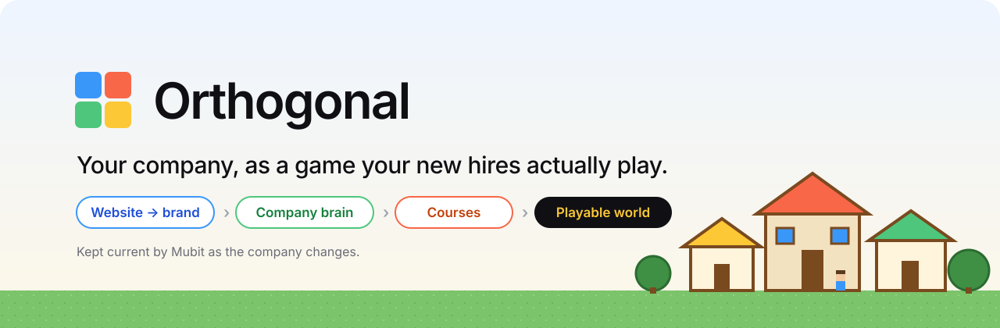

<br>

[](next.config.ts)
[](convex/)
[](src/llm/mubit.ts)
[](world/)
[](src/lib/onboarding/vercel.ts)
[](tsconfig.json)

**Paste your website. Get a branded onboarding game your new hires play on their phone.**

[**What it does**](#what-it-does) · [**See it**](#see-it) · [**Architecture**](#architecture) · [**Run locally**](#run-locally) · [**Product brief**](PRD.md)

</div>

---

Onboarding is a pile of docs nobody reads. The facts a new hire needs are already out there:
on the website, in Slack, in GitHub, in Notion. **Orthogonal** reads them, builds a company
brain that cites its sources, writes courses from it, and ships them as a small Stardew-style
town where every building is a game. When the company changes, Mubit notices and the manager
pushes the update with one click.

## What it does

| | |
| --- | --- |
| **Website to brand in ~20 s** | Paste a URL. Logo, fonts, colours and style cues (glass, gradients, radius) come back as four theme cards. Measured: apple.com 20 s, notion.com 18 s, linear.app 28 s. One click applies the look everywhere. |
| **A company brain** | The website crawl and connected tools (GitHub, Slack, Jira, Notion, Google Drive, uploaded files) become facts. Every fact cites the chunk it came from. |
| **Courses from the brain** | Company 101, People, Tools, Hard Conversations: validated course specs whose steps cite brain facts. The manager edits them in the editor. |
| **A world to play** | A Phaser town with one building per course. Each building plays a game: a Pokemon-style **battle**, an Ace Attorney **dilemma**, or **word match**. |
| **Live link + QR in under a second** | Publish templates the world from current content (no model call). Measured: 0.8 s to a link; a world builds in 1 to 4 ms. |
| **Continuous learning via Mubit** | Source changes stale the facts that cited them, courses get rewritten steps with **New** badges, and the manager clicks **Update courses**. Theme and design picks are fed back so the next recommendation is better. |

## See it

<table>
<tr>
<td width="33%">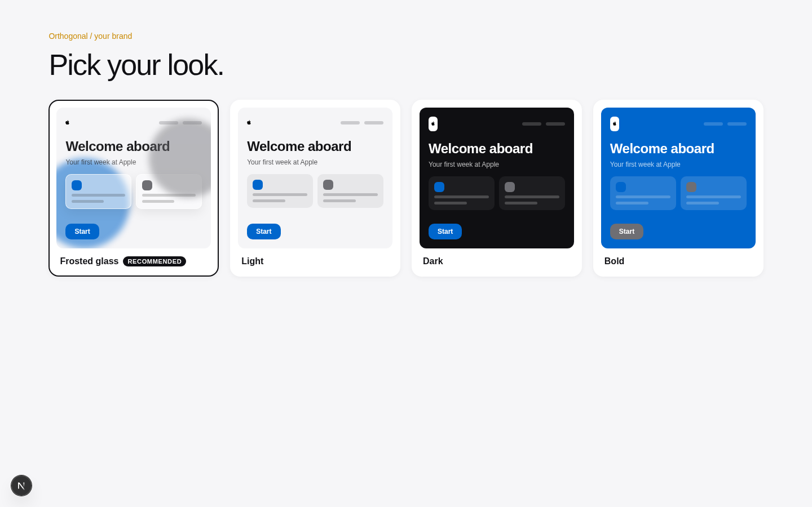</td>
<td width="33%">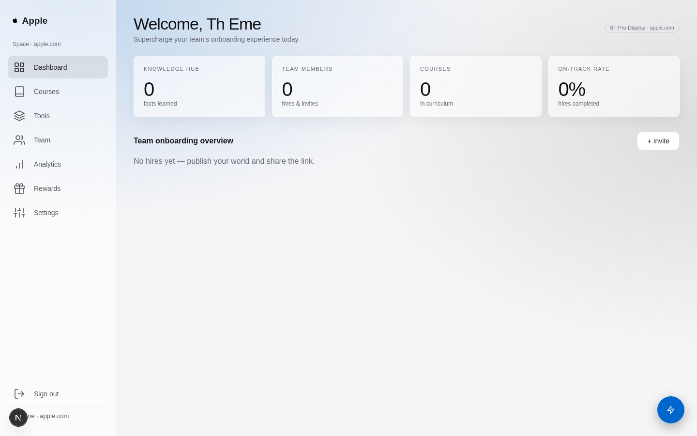</td>
<td width="33%">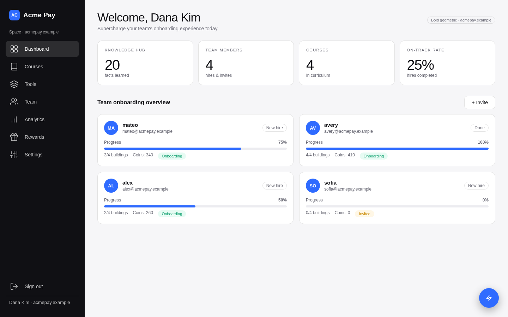</td>
</tr>
<tr>
<td><b>Pick your look.</b> apple.com in 20 s, glass detected.</td>
<td><b>Branded everywhere.</b> The dashboard takes the picked theme.</td>
<td><b>One dashboard.</b> Courses, team, tools, rewards.</td>
</tr>
<tr>
<td>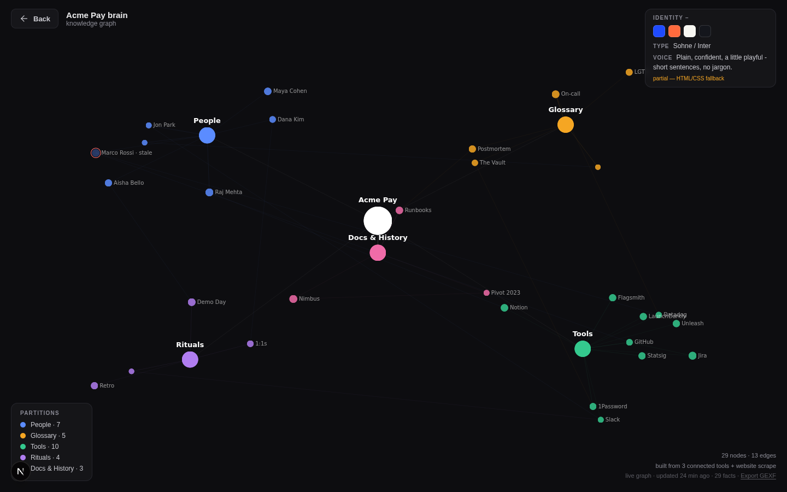</td>
<td>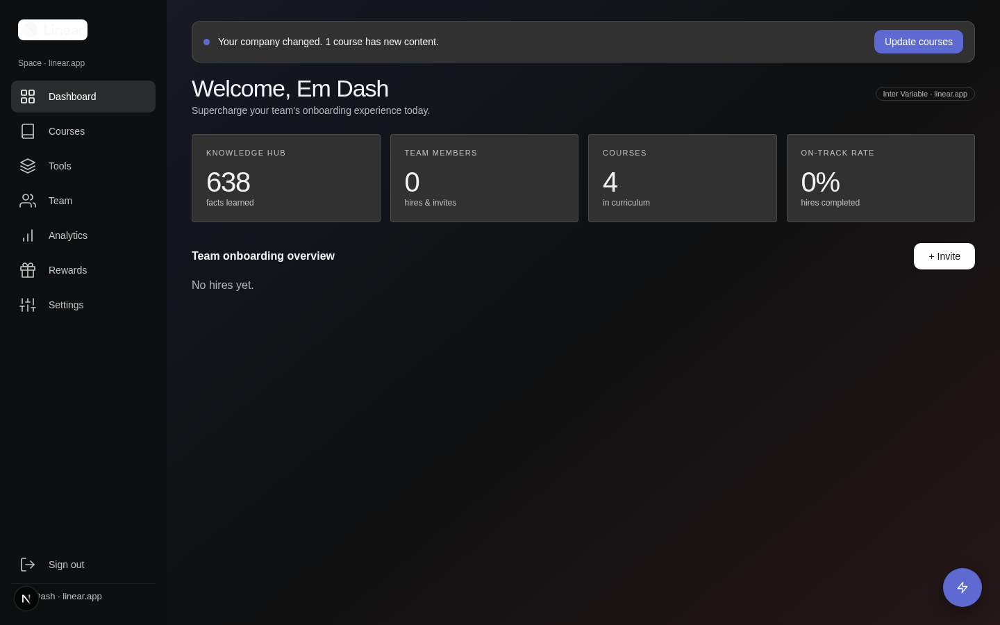</td>
<td>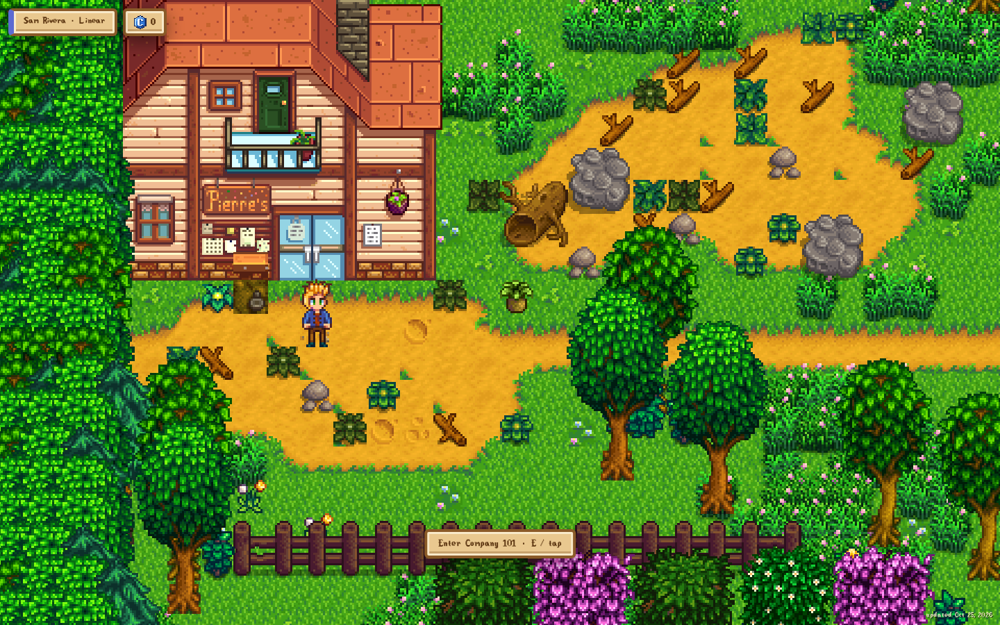</td>
</tr>
<tr>
<td><b>Company brain.</b> Facts with sources.</td>
<td><b>Your company changed.</b> New content, one button.</td>
<td><b>The town.</b> One building per course.</td>
</tr>
<tr>
<td>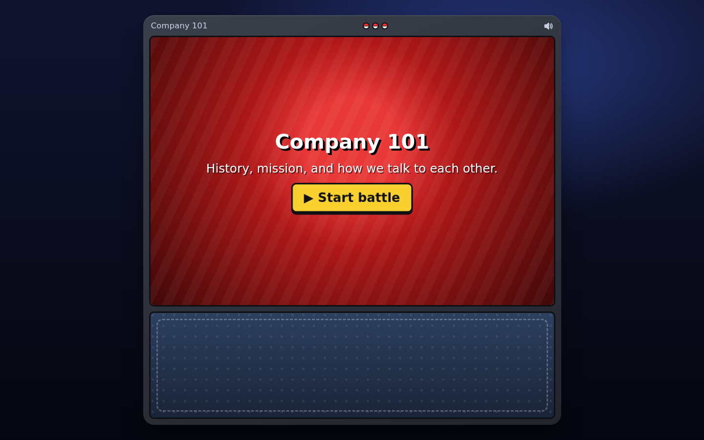</td>
<td>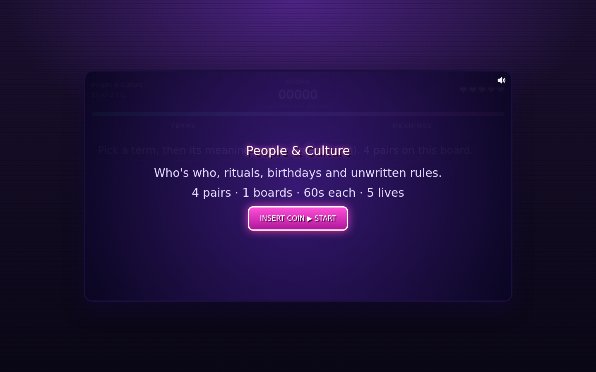</td>
<td>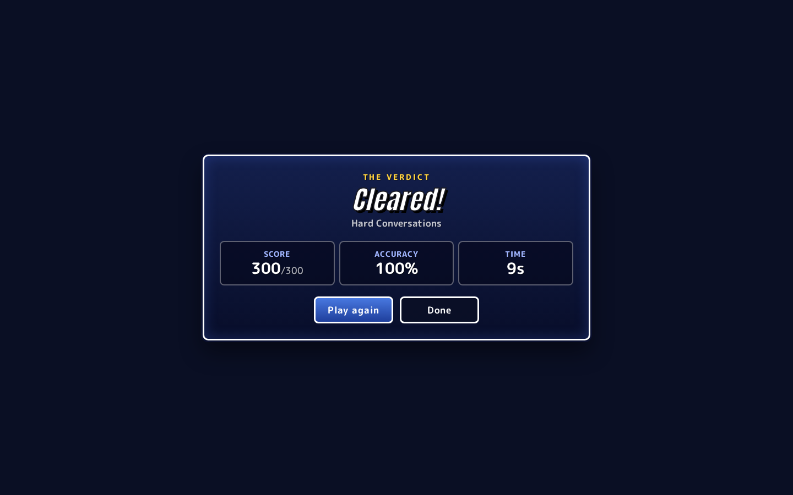</td>
</tr>
<tr>
<td><b>Battle.</b> Quiz rounds from the course.</td>
<td><b>Word match.</b> Names and what they mean here.</td>
<td><b>Dilemma.</b> Hard conversations, your own cast.</td>
</tr>
</table>

## Architecture

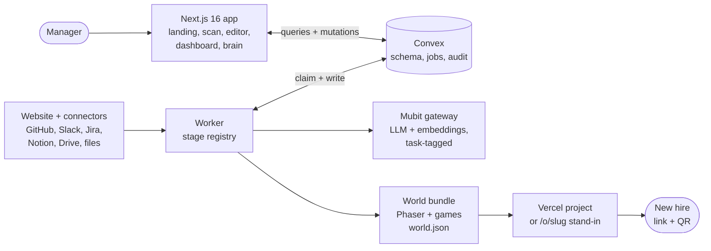

Every job is a `StageDefinition` in [`src/worker/stages`](src/worker/stages), registered in
[`src/worker/registry.ts`](src/worker/registry.ts). The model never writes UI: it returns JSON
checked by Zod, with fixed system prompts and bounded retries.

| Chain | Stages | What happens |
| --- | --- | --- |
| **Scan** (seconds) | `extract_design` → `ready` | dembrandt plus an HTML/CSS read, in parallel. Ends in theme cards. |
| **Enrich** (background) | `crawl` → `analyse` → `seed_brain` → `generate_courses` | Pages to chunks, facts with citations, then course specs. Never blocks the scan. |
| **Drift** | `sync_connector`, `cascade` | Changed items are re-extracted; facts whose passage changed go stale. |
| **Publish** | `deploy` | Templates `world.json` from current courses and brain, deploys on a reserved worker lane. |

## The Mubit loop

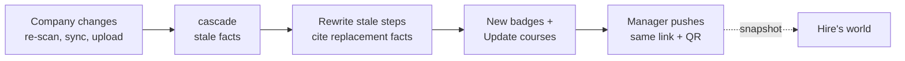

- **Every LLM and embedding call** goes through one adapter, [`src/llm/mubit.ts`](src/llm/mubit.ts), tagged with its task name so Mubit learns per task.
- **Drift:** a pricing page edit reached a New badge in ~36 to 40 s; **Update courses** took 0.6 s and kept the same link. Hires see a snapshot until the manager pushes.
- **Brand learning:** theme and Design-tab picks become `brand_decisions` fed back to `brand.recommend`, alongside precedents from similar companies.

## Run locally

```bash
npm install && npm run dev
```

One command boots the local Convex backend (Docker), pushes functions, seeds the demo space,
and starts Next and the worker. It prints the URLs; sign in as `demo@orthogonal.dev` /
`demo-password`. **No keys needed:** every provider has a labelled offline stand-in, and
anything without one says so instead of faking success.

| | |
| --- | --- |
| Keys | [`.env.example`](.env.example) lists every variable; `npm run check:env` tests each configured service |
| Checks | `npm run lint` · `npm run typecheck` · `npm test` · `npm run test:e2e` |
| Demo | `npm run demo:reset` · `npm run demo:change -- <spaceId> "<text>" "<replacement>"` |

## Read next

| | |
| --- | --- |
| [PRD.md](PRD.md) | What we are building, screen by screen |
| [AGENTS.md](AGENTS.md) | Rules for contributors, human or otherwise |
| [DECISIONS.md](DECISIONS.md) | Every product and engineering decision, numbered |
| [docs/BUILD-CONTRACT.md](docs/BUILD-CONTRACT.md) | Shared contracts: schema, pipeline, ingest |
