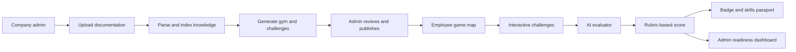

# Plan 4 (Richard): GymQuest — Pokémon-style engineering onboarding

Cleaned up from Richard's paste: the leftover chat-UI styling is removed, the diagram is rebuilt as Mermaid, and the
content is otherwise unchanged.

## Richard's original idea (verbatim)

> So basically what my idea is essentially we do Pokémon-style game for onboarding, and every gym and every location
> has some sort of different onboarding, whether that's department-based or whether that's code-based. And companies
> can essentially insert all their onboarding material, create agents which they validate themselves, and each part
> of this gym is like a mini level which teaches you essentially the skills you need and how to respond. Then after
> you defeat the gym boss, this essentially qualifies you to go out and touch the code base. A lot of companies have a
> very big problem on onboarding. Nothing is standardized, and a lot of companies don't actually know what skills they
> want out of someone onboarding. They just go, huh, qualitatively this person is all right, and they've experience,
> et cetera, but there's still many holes in their knowledge, and especially if they're using legacy systems or
> something like that which hasn't been touched, they will be useless in a time of emergency, and information is just
> passed on at a whim, and information which should be documented isn't being documented and is only being held by
> senior engineers.

---

**Working title:** GymQuest — turn company knowledge into playable engineering readiness. (Domain idea: gitquest.dev)

The core idea is to turn employee onboarding from a collection of documents, meetings and tribal knowledge into a
game-based training and qualification system. Engineers prove they understand a company's systems before being
trusted with increasingly sensitive parts of its codebase.

This is more than gamified documentation. It makes hidden engineering knowledge explicit, standardises what people
need to know, and objectively measures whether someone is ready to work on a system.

## 1. The problem

Most engineering teams have an onboarding problem that becomes a business risk.

- **Knowledge is fragmented.** Critical information lives across internal wikis, Slack messages, old pull requests
  and individual engineers' heads.
- **Onboarding is inconsistent.** Two engineers joining the same team can finish onboarding with completely different
  levels of understanding.
- **Competence is assumed, not demonstrated.** Experience and interviews don't guarantee that someone understands a
  company's architecture, deployment process or failure modes.
- **Legacy systems are dangerous knowledge gaps.** A new engineer may be productive on modern services but unable to
  safely troubleshoot a critical system that only a few senior engineers understand.
- **Senior engineers become bottlenecks.** They repeatedly explain the same systems, answer the same questions, and
  become the default escalation path.

The result is slower productivity, more operational risk, and too much reliance on institutional memory.

## 2. The solution

GymQuest is a customisable, Pokémon-inspired onboarding platform where every company builds its own world of
engineering knowledge.

Companies upload their internal documentation, architecture diagrams, runbooks, coding standards and incident
reports. They then define learning paths and configure AI agents to check whether employees can apply that knowledge.

Each location represents a team, department, system or skill. Each gym contains short, interactive challenges.
Employees earn badges by demonstrating competence, and defeating a gym boss unlocks the next stage of access or
responsibility.

The progression:

1. **Enter the world:** learn the company's structure, tools, culture, security basics and engineering workflow.
2. **Complete gym challenges:** department-specific quizzes, code-reading exercises, architecture puzzles and
   incident simulations.
3. **Defeat the gym boss:** a practical assessment of whether the employee can apply their knowledge under realistic
   conditions.
4. **Earn access and trust:** a verified skills badge and eligibility for the relevant tasks, tools or access
   permissions.

The key design principle: employees don't just read documentation; they demonstrate that they understand it.

## 3. Core product features

**A. The company world map.** Each company creates its own onboarding map with different regions and gyms.
- Engineering: backend, frontend, infrastructure, CI/CD.
- Departments: product, security, data, operations.
- Legacy systems: payment processing, authentication, billing, critical internal services.

Employees follow a role-specific path rather than completing irrelevant training.

**B. Knowledge ingestion.** Admins upload documentation, repository guides, incident postmortems and runbooks. The
platform uses this material to ground challenges in the company's actual systems. The differentiator: knowledge is
converted into structured learning objectives, questions, scenarios and assessments instead of staying as static
documentation.

**C. Company-controlled validation agents.** Companies define what competence means for each gym. Agents check
answers against approved documentation, give hints, identify knowledge gaps, and score practical exercises against
explicit rubrics. For the MVP, make the criteria visible and require human approval for high-stakes qualifications.
The agent should not invent company policy or be the only authority for production access.

**D. Gym battles.** Each gym ends with a practical challenge rather than another multiple-choice quiz. Example: the
payments gym gives a simulated failed deployment. The employee must trace the request flow, identify the likely
failure, consult the correct runbook, and choose a safe recovery procedure.

**E. Skills passport.** Each employee has a profile showing completed gyms, demonstrated skills, outstanding gaps,
assessment results, and the date each qualification was earned. This gives a consistent, auditable view of readiness
instead of relying entirely on a manager's impression.

## 4. The hackathon MVP

Don't try to build the whole platform. Build one compelling end-to-end experience that proves the idea: one
fictional company, one role, one complete onboarding journey.

Must ship:

- [ ] Admin uploads a small set of engineering documentation.
- [ ] System generates a structured gym with learning objectives and challenges.
- [ ] Employee enters a pixel-art map and sees available levels.
- [ ] Employee completes at least two interactive challenges.
- [ ] AI evaluates an answer using the uploaded documentation and a scoring rubric.
- [ ] Employee faces a final gym boss scenario.
- [ ] Passing unlocks a badge and a skills-readiness report.
- [ ] Admin can see the employee's results and knowledge gaps.

### Example demo journey

A fictional company with a legacy payment service makes the business problem tangible.

| Level | What the employee does | Proof |
|---|---|---|
| 1. Architecture Town | Learns the main services, how requests flow, and which repository owns payments | Correctly explain a simple request flow |
| 2. Legacy Dungeon | Investigates a simulated failure using a runbook and a historical incident report | Identify the likely cause and the safe next step |
| 3. The Production Guardian | A simulated incident tests diagnosis, escalation, rollback decisions, and what must not be changed | Meet a predefined rubric and explain the reasoning |

At the end, the user gets a report showing what they passed, what they missed, and which knowledge sources support
the assessment.

**Important:** for the hackathon, a badge means eligibility or simulated access. Don't connect an unproven AI score
directly to real production permissions.

## 5. Recommended tech stack

| Layer | Recommendation | Purpose |
|---|---|---|
| Frontend | Next.js + React | Admin dashboard, player map, challenges |
| Styling | Tailwind CSS | Fast UI iteration |
| Game visuals | Phaser, or a lightweight CSS/SVG map | Playable 2D world |
| Backend | Next.js API routes | Users, challenges, assessment results |
| Database | Supabase + PostgreSQL | Companies, gyms, progress, scores |
| Knowledge retrieval | pgvector or equivalent | Retrieve relevant company documentation |
| AI | An LLM API with structured outputs | Generate challenges and assess responses |
| Document parsing | Markdown, PDF and text extraction | Turn source material into searchable knowledge |
| Deployment | Vercel + Supabase | Fast demo deployment |

For a short hackathon, prioritise a clean web dashboard and a clickable, game-like map over a full game engine. Use a
real AI assessment loop, but constrain it to a small, curated set of documents.

### Basic system architecture

The important technical detail: **separate challenge generation from challenge validation.** An agent can propose a
question, but the company should be able to approve the expected answer, the source material and the scoring criteria.

## 6. Execution plan (24-hour version)

Organise around the demo journey rather than isolated features.

| Hours | Phase | Work |
|---|---|---|
| 0–2 | Define | Lock the problem and demo: choose the fictional company, create sample docs, define the three levels, agree what passing the boss means |
| 2–7 | Build | Playable frontend: map, level selection, challenge screens, progress indicator, badge screen, using mock data at first |
| 7–12 | Integrate | Knowledge and AI loop: ingest sample docs, retrieve passages, generate or load challenges, return rubric-based feedback with source references |
| 12–17 | Connect | End-to-end flow: persist progress, calculate scores, unlock the boss, issue the badge, show the skills report to an admin |
| 17–21 | Polish | Fix integration bugs, improve visuals, add source citations, make sure the demo works with a known dataset |
| 21–24 | Present | Rehearse from admin upload to qualification; prepare a backup recording and seeded data in case the live AI call fails |

**Team of four:** frontend/game (map, challenges, polish, progression); backend (DB, ingestion, progress, scoring);
AI engineer (retrieval, challenge generation, validation agent); product/full-stack (admin experience, integration,
testing, pitch). With only two people, build one full-stack app and use pre-authored challenges.

## 7. What makes this stand out to judges

Pitch the business outcome, not just the Pokémon inspiration.

- **Objective readiness, not attendance:** measures whether someone can apply knowledge, not whether they've read a
  list of documents.
- **Institutional knowledge becomes reusable:** senior engineers turn explanations, incident reports and undocumented
  workflows into repeatable training material.
- **Company-specific, not generic AI training:** each gym is grounded in the organisation's actual architecture,
  policies, terminology and risks.
- **Knowledge gaps become visible:** managers see which critical systems lack trained engineers and where
  documentation or training falls short.

## 8. How to measure success

| Metric | What it shows |
|---|---|
| Time to complete onboarding | Whether the process becomes more efficient |
| Assessment pass rate | Whether training is calibrated appropriately |
| Performance on unseen scenarios | Whether employees apply knowledge rather than memorise answers |
| Repeat questions to senior engineers | Whether knowledge is becoming reusable |
| Critical systems with qualified staff | Whether operational resilience is improving |
| Documentation gaps discovered | Whether the platform improves the underlying knowledge base |

A strong demonstration: a learner fails a legacy-system scenario, gets targeted feedback citing the relevant runbook,
studies it, and then passes a *different* scenario testing the same competency. That proves the product is a learning
loop, not just a quiz generator.

## 9. Risks to address early

- **Incorrect AI assessments:** ground answers in approved sources, show evidence, use explicit rubrics, keep human
  review for critical qualifications.
- **Outdated documentation:** show provenance and last-reviewed dates; flag conflicting or stale material rather than
  presenting it as authoritative.
- **Gaming the system:** use practical scenarios, varied questions and follow-up reasoning, not just multiple choice.
- **Sensitive source material:** use fictional or sanitised data. A real product needs access controls, tenant
  isolation and careful handling of proprietary code and incident reports.
- **Gamification without substance:** every badge should represent a clearly defined skill with measurable criteria.

## 10. The 90-second pitch

> **GymQuest — level up your engineering onboarding.**
>
> Every company has a hidden knowledge problem. Critical information lives in scattered documents, legacy systems,
> old incidents, and the heads of senior engineers. New hires are expected to absorb it all, but companies rarely have
> a consistent way to know whether someone is actually ready to work on their systems.
>
> GymQuest turns onboarding into a Pokémon-inspired adventure. Companies upload their documentation and define the
> skills their engineers need. Our platform turns that knowledge into interactive levels, department-specific gyms,
> and AI-assisted practical assessments.
>
> Employees don't just read about a system. They investigate failures, navigate architecture, solve realistic
> engineering challenges, and defeat a final gym boss by demonstrating their competence.
>
> Each completed gym earns a verified skills badge and adds to a personal skills passport. Managers can see who is
> qualified to work on which systems, where knowledge gaps remain, and which critical systems rely on too few people.
>
> We're turning institutional knowledge into measurable engineering readiness.
>
> **Don't just onboard engineers. Train them, test them, and prove they're ready.**

**Recommendation:** build the hackathon around one central promise: *"Before an engineer touches a critical system,
they should be able to prove they understand it."* The game is the engaging interface. The real product is the
company's ability to define, teach and measure engineering competence.

---

## Review: how this plan feeds the final plan

**Strengths**
- The sharpest problem statement and pitch. The "legacy system nobody understands" pain lands with any engineer
  judging.
- The best boss design: Legacy Dungeon → Production Guardian, a practical incident and not a quiz.
- "Separate generation from validation": the company approves the expected answer, sources and rubric.
- Skills passport and readiness report, plus "badge = eligibility, not real production access".
- The fail → targeted feedback → pass a *different* scenario loop proves learning, not memorisation.

**Gaps**
- **Mubit isn't mentioned at all.** The judging criteria require a correction to become a model update, and judges
  weight Mubit use at 25%.
- The timeline is generic (24 hours) and ignores Mubit's training windows.
- Supabase + Next.js API routes is fine, but the plan has no correction loop to store.
- Engineering onboarding at a startup is low volume (a few hires a month). We need to explain why it's a *recurring*
  task.

**Taken into the final plan:** the GymQuest name and pitch line, the legacy payments incident as the engineering gym
and boss, generation/validation separation, the skills passport, "badge = eligibility", the fail → different
scenario → pass loop, the success metrics slide, the risk list.

**Changed:** the product is generalised beyond engineers. GymQuest onboards any role at any company, and the
engineering gym (Legacy Dungeon → Production Guardian) becomes one role pack among several (company, compliance,
support, engineering, plus any pack a company uploads). The AI evaluator becomes the Mubit-trained grader with a
correction loop. Recurring volume comes from every hire in every role, plus annual compliance training for all staff.
The pitch line becomes "before anyone handles a critical task, they should prove they can".
